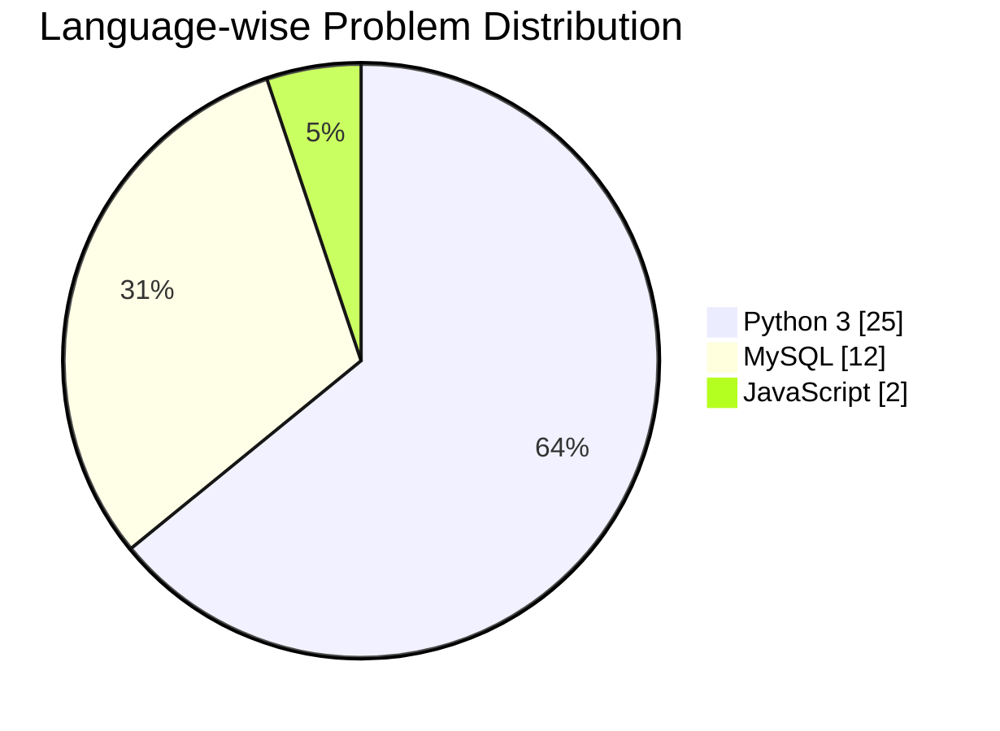
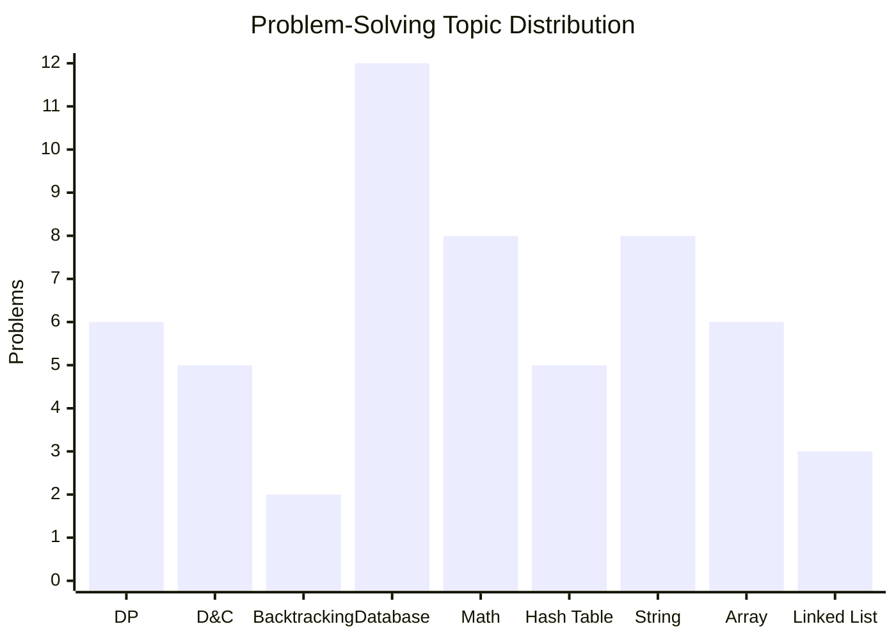

# Shrikrushna Dhebe

### Software Developer | Python | Problem Solving | Data & Algorithms

*Learning, solving, improving — one problem at a time.*

---

## 👨‍💻 About Me

I'm Shrikrushna Dhebe, a Computer Science graduate focused on strengthening my programming fundamentals, problem-solving ability, and software development skills.

I use LeetCode to practice algorithms, understand data structures, improve database knowledge, and develop consistent coding habits.

- 🐍 Primary coding language: Python 3
- 🗄️ Database practice: MySQL
- 🌐 Additional practice: JavaScript
- 🧠 Interested in: DSA, Algorithms, Database Systems
- 🎯 Goal: Become a better problem solver and software developer.
- 📈 Focus: Consistency, clean logic, and continuous improvement.

---

## 📊 LeetCode Performance

> Live statistics card: dynamically generated from my public LeetCode profile.

## 💻 Language Distribution

Current public profile snapshot:

| Language | Problems |
|:---|---:|
| Python 3 | 25 |
| MySQL | 12 |
| JavaScript | 2 |
| **Total language entries** | **39** |

## 🧠 Problem-Solving Skills

### Advanced

| Topic | Count |
|:---|---:|
| Dynamic Programming | 6 |
| Divide and Conquer | 5 |
| Backtracking | 2 |

### Intermediate

| Topic | Count |
|:---|---:|
| Database | 12 |
| Math | 8 |
| Hash Table | 5 |

### Fundamental

| Topic | Count |
|:---|---:|
| String | 8 |
| Array | 6 |
| Linked List | 3 |

*Topic counts are LeetCode skill-tag counts, not necessarily unique problems.*

---

## 📈 My Coding Journey

My current focus is to build a strong foundation before moving towards more complex algorithmic problems.

| Area | Current Focus |
|:---|:---|
| Python | Problem solving and logic |
| SQL | Database queries |
| JavaScript | Programming fundamentals |
| DSA | Algorithms and data structures |
| Consistency | Regular practice |

## 🎯 My Goals

- [ ] Solve 100 problems
- [ ] Solve 250 problems
- [ ] Solve 500 problems
- [ ] Master Arrays and Strings
- [ ] Improve Dynamic Programming
- [ ] Strengthen SQL and Database concepts
- [ ] Participate in coding contests
- [ ] Maintain a consistent coding streak

---

## 🔥 Coding Activity

## 📬 Connect With Me

- GitHub: [Shrikrishna-dhebe-12](https://github.com/Shrikrishna-dhebe-12)
- LeetCode: [F6hN95ebDK](https://leetcode.com/u/F6hN95ebDK/)

---

**"Consistency beats intensity. Every problem solved is progress."**

⭐ Thanks for visiting my profile!

